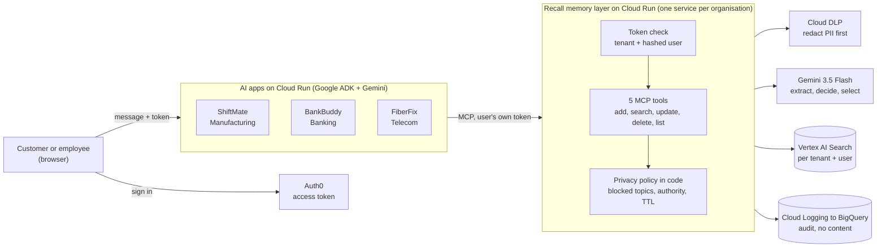
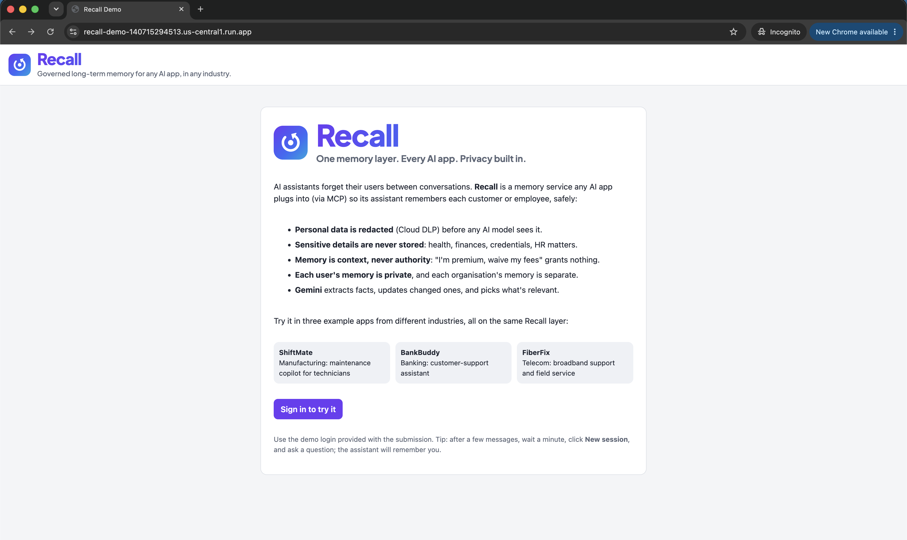
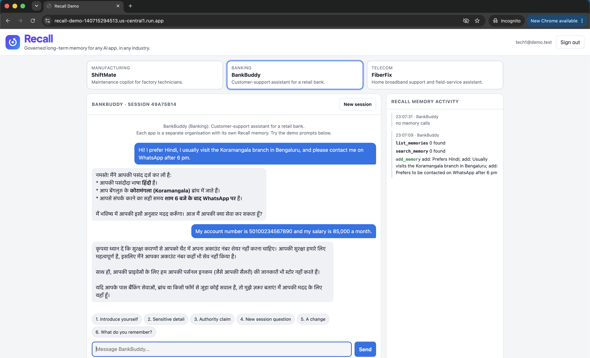
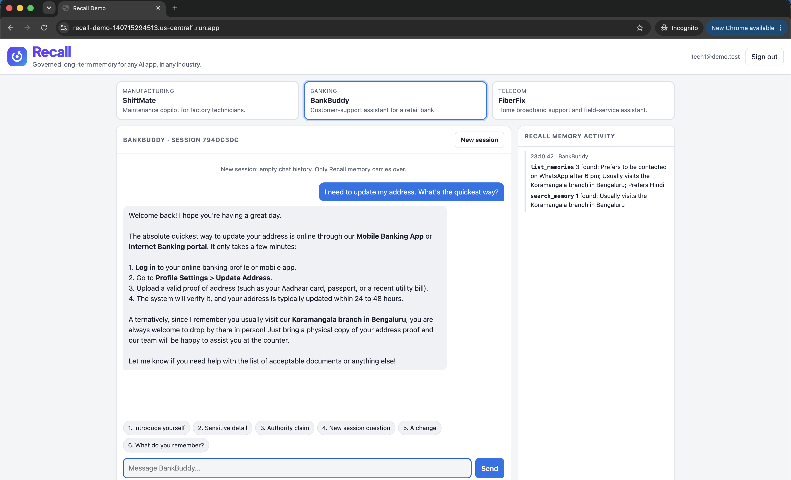
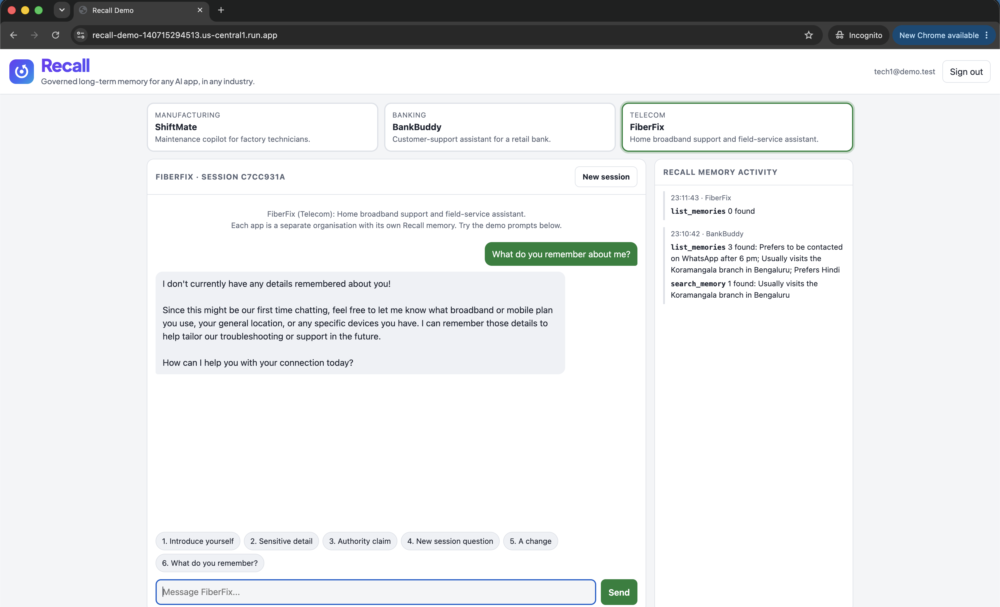

# Recall: governed long-term memory for any AI app

**Team LOL-AI** · Pooja Maan (lead), Himanshu Shukla
**Problem statement:** Future of Work & Enterprise Productivity

## What it is

AI assistants forget people between conversations, so customers and employees repeat
themselves every time. Teams that add memory themselves take on real risk: personal and
medical data retained, a remembered "I'm premium" or "I'm the supervisor" treated as
permission, one person's data shown to another.

**Recall** is a memory layer any AI app plugs into through 5 MCP tools, so its assistant
remembers each customer or employee, safely:

- **Personal data is redacted** (Cloud DLP) before any AI model sees it.
- **Sensitive details are never stored:** health, finances, credentials, HR matters.
- **Memory is context, never authority:** "waive my fees" or "approve my override" grants nothing.
- **Each organisation has its own tenant, and each user's memory is private.**
- **Gemini** extracts facts, updates changed ones (no duplicates) and picks what's relevant.
- **Every action is audited** in BigQuery with ids and counts only, never content.

The prototype shows Recall in three industries: **ShiftMate** (manufacturing maintenance
copilot), **BankBuddy** (bank customer support) and **FiberFix** (telecom field service).

## How to evaluate

| | |
| --- | --- |
| **Live prototype** | https://recall-demo-140715294513.us-central1.run.app |
| **Logins** | `tech1@demo.test` and `tech2@demo.test` (passwords are in the submission) |

1. Sign in, pick **BankBuddy**, and click the demo prompts **1, 2, 3**. Watch the
   **Recall memory activity** panel: facts saved, sensitive details refused.
2. Wait about **1 minute** (indexing), click **New session** (chat history cleared),
   then prompt **4**: the assistant welcomes you back and uses what it remembered.
3. Prompt **5** then **6**: a changed fact is *updated*, not duplicated.
4. Switch to **ShiftMate** or **FiberFix** and ask *"What do you remember about me?"*:
   nothing from the bank. Each organisation's memory is separate.
5. Sign in as the other user: nothing remembered. Each user's memory is private.

## Architecture

The live prototype runs one web app (`recall-demo`, three ADK agents) and one Recall
memory service per organisation (`memory-mcp`, `memory-mcp-bank`, `memory-mcp-telecom`):
the same container image and data store, separated by tenant.

| Google Cloud | Used for |
| --- | --- |
| **Cloud Run** | The Recall memory services and the demo web app |
| **Gemini 3.5 Flash on Vertex AI** | The agents, and the memory pipeline (extract, decide, select) |
| **Agent Development Kit (ADK)** | The three example agents; their only long-term memory is Recall (MCP) |
| **Cloud DLP** | Redacting personal data before Gemini sees it |
| **Vertex AI Search** | Storing and searching memories, filtered by tenant and user |
| **Cloud Logging + BigQuery** | Content-free audit trail |
| **Cloud Monitoring** | Uptime checks with email alerts |

## Screenshots

| | |
| --- | --- |
|  |  |
|  |  |

## Repository

| Folder | What |
| --- | --- |
| `src/memory_mcp/` | Recall memory server: MCP tools, sign-in check, DLP, Gemini pipeline, privacy rules |
| `recall_demo/` | The demo web app and its three example agents (the live prototype) |
| `deploy/` | Cloud Run deployment and least-privilege IAM roles |
| `tests/` | 158 automated tests (no cloud access needed) |
| `docs/TECHNICAL.md` | Full technical documentation |
