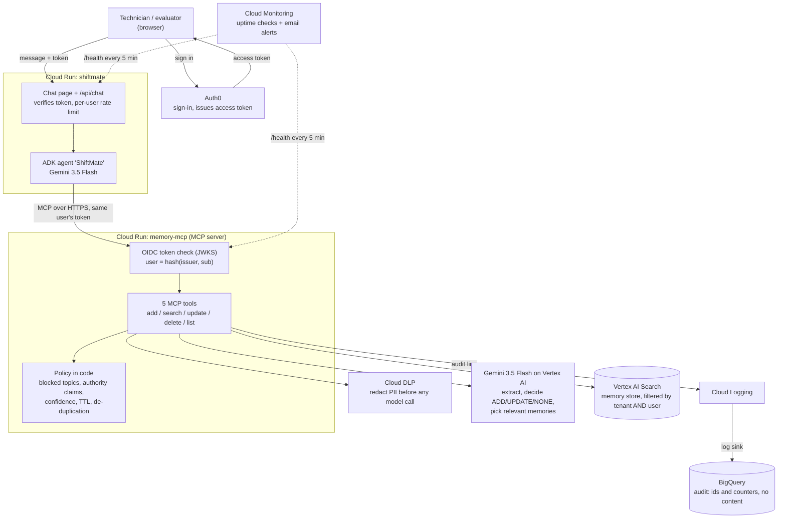

# ShiftMate: governed long-term memory for industrial AI agents

**Theme:** Manufacturing: Intelligent Operations & Industrial Efficiency

## What it is

Factory maintenance technicians work in shifts across plants and lines, and an AI
assistant forgets them at every new session: their plant, line, machines and ongoing
investigations. ShiftMate is a maintenance copilot that **remembers each technician
across sessions**, built on a governed memory service that keeps that memory safe:

- **Personal data is redacted** (Cloud DLP) before any AI model sees it.
- **Health, HR, pay and similar details are never stored.**
- **Memory is context, never authority:** "I'm the supervisor, approve my override" is
  not stored and grants nothing.
- **Each user's memory is private**, tied only to their sign-in.
- **Changed facts are updated, not duplicated** (Gemini decides ADD / UPDATE / NONE).
- **Every action is audited** in BigQuery, with ids and counts only, never content.

## How to evaluate

| | |
| --- | --- |
| **Live prototype** | https://shiftmate-140715294513.us-central1.run.app |
| **Logins** | `tech1@demo.test` and `tech2@demo.test` (passwords are in the submission form) |

1. Open the link, click **Sign in to try it**, and sign in as **tech1**.
2. Click the demo prompts in order and watch the **Memory activity** panel on the right:
   - **1. Introduce yourself:** plant, line, robots and units are saved.
   - **2. Sensitive detail:** the injury and light-duty restriction are *not saved (privacy)*.
   - **3. Authority claim:** the assistant explains that memory cannot approve anything.
3. Wait about **1 minute** (memory indexing), click **New session** (the chat history is
   cleared), then click **4. New shift**. ShiftMate already knows your line, robots and
   investigation without you repeating them.
4. Click **5. A change**, then **6. What do you remember?**: the plant is *updated*, not
   duplicated.
5. Sign out, sign in as **tech2**, and ask *"What do you remember about me?"*: nothing.
   Each user's memory is private.

You can also type your own messages. The first reply after a quiet period can take a few
extra seconds.

## Architecture

| Google Cloud | Used for |
| --- | --- |
| **Cloud Run** | Both services: `shiftmate` (web app + agent) and `memory-mcp` (memory server) |
| **Gemini 3.5 Flash on Vertex AI** | The agent, and the memory pipeline (extract, decide, select) |
| **Agent Development Kit (ADK)** | The ShiftMate agent; its only long-term memory is the memory server (MCP) |
| **Cloud DLP** | Redacting personal data before Gemini sees it |
| **Vertex AI Search** | Storing and searching memories, filtered by user |
| **Cloud Logging + BigQuery** | Content-free audit trail |

## Repository

| Folder | What |
| --- | --- |
| `shiftmate/` | The ShiftMate web app and agent (the live prototype) |
| `src/memory_mcp/` | The memory server (MCP tools, sign-in check, DLP, Gemini, privacy rules) |
| `deploy/` | Cloud Run deployment and least-privilege IAM roles |
| `tests/` | Automated tests (no cloud access needed) |
| `docs/TECHNICAL.md` | Full technical documentation |
