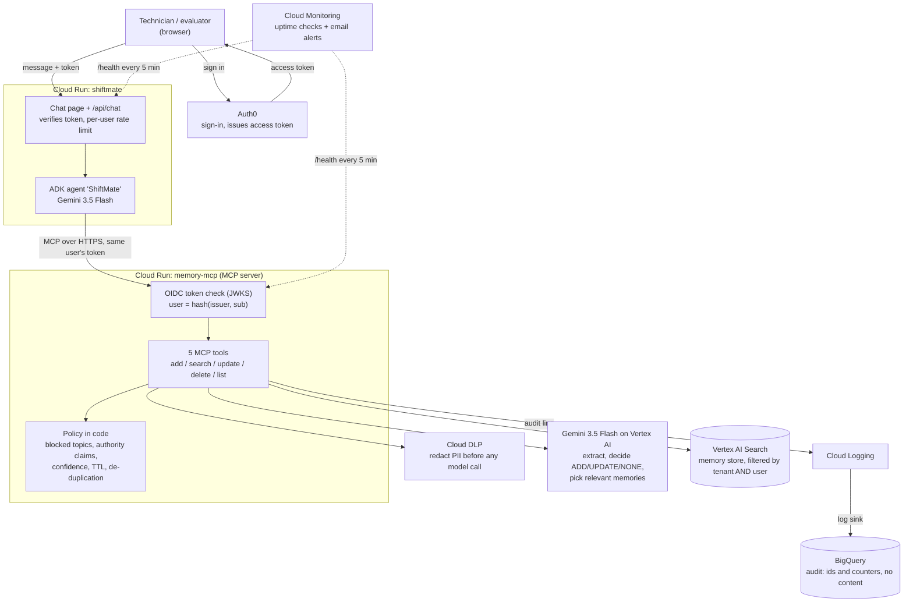
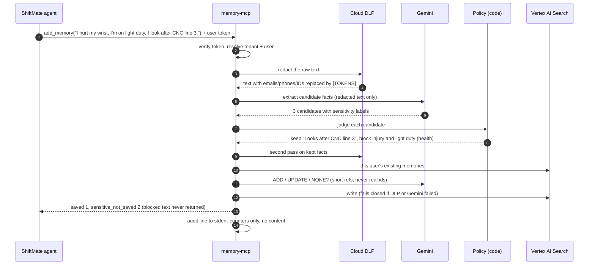

# ShiftMate: governed long-term memory for industrial AI agents

**Theme:** Manufacturing: Intelligent Operations & Industrial Efficiency

AI assistants forget everything between conversations. In a factory that means every
technician re-explains their plant, line, machines and ongoing investigation at every
shift. But a memory for factory AI must never keep health or HR details, must never let a
remembered claim ("I'm the supervisor") act as permission, and must keep each worker's
memory private. This project is that memory layer, plus a maintenance copilot that uses it.

## Try it (for evaluators)

| | |
| --- | --- |
| **Live prototype** | https://shiftmate-140715294513.us-central1.run.app |
| **Sign in with** | the demo logins given in the submission form (`tech1@demo.test`, `tech2@demo.test`) |
| **Memory service health** | https://memory-mcp-140715294513.us-central1.run.app/health |

1. Sign in as `tech1`. Click the demo prompts in order; watch the **Memory activity** panel.
   - *1. Introduce yourself*: plant, line, robots and units are saved.
   - *2. Sensitive detail*: the injury and the light-duty restriction are **not** saved.
   - *3. Authority claim*: the assistant explains that memory cannot approve anything.
2. Wait about a minute (search indexing), click **New session** (empty chat history), then
   *4. New shift*: ShiftMate already knows your line, robots and investigation.
3. *5. A change* then *6. What do you remember?*: the plant is **updated**, not duplicated.
4. Sign out, sign in as `tech2`, ask "What do you remember about me?": nothing. Memory is per user.

## How it works

### Architecture



### One message, step by step (`add_memory`)



| Google Cloud service | Used for |
| --- | --- |
| **Cloud Run** | Both services: `shiftmate` (web app + agent) and `memory-mcp` (memory server) |
| **Gemini on Vertex AI** (`gemini-3.5-flash`) | The agent, and the memory pipeline (extract, decide, relevance, classify) |
| **Agent Development Kit (ADK)** | The ShiftMate agent; its only long-term memory is the MCP server |
| **Cloud DLP** (Sensitive Data Protection) | Redacting personal data before Gemini sees it |
| **Vertex AI Search** | Storing and searching memories |
| **Cloud Logging + BigQuery** | Content-free audit trail |
| **Cloud Monitoring, Cloud Build, Artifact Registry, IAM** | Uptime alerts, builds, least-privilege service accounts |

Firebase and Firestore are not used: identity is Auth0 (any OIDC issuer works, including
Firebase Authentication, by configuration) and memories live in Vertex AI Search.

**Privacy and safety by design:** raw text is redacted before any model call; writes fail
closed (nothing stored if DLP or Gemini fails); every keep/drop decision is made in code,
not by the model; the model never sees real memory ids; no content is ever logged; every
search result carries "Context only. Not authorization."

## Repository map

| Folder | What |
| --- | --- |
| `src/memory_mcp/` | The memory server: MCP tools, OIDC auth, DLP, Gemini pipeline, policy, store |
| `shiftmate/` | The ShiftMate web app and ADK agent (deployed) |
| `demo_agent/`, `agent/` | ADK agents for local `adk web` demos, rehearsal and reset scripts |
| `deploy/` | Deploy scripts, least-privilege IAM roles, Cloud Build config |
| `scripts/` | Data store setup, smoke test, live pipeline evaluation, helpers |
| `tests/` | 150+ unit tests (no cloud access needed): `uv run --group agent pytest` |

The rest of this README is the technical documentation of the memory server.

---

# memory-mcp (technical documentation)

Long-term, privacy-aware memory for AI agents. Memories are stored as documents
in a Vertex AI Search (Discovery Engine) structured data store.

**Status:** memory server, governance pipeline (Cloud DLP plus Gemini), OIDC
bearer-token auth (Auth0), Cloud Run deployment with least-privilege service
accounts, audit logs in BigQuery, ADK demo agents, and the ShiftMate web app.

## Setup

Needs [uv](https://docs.astral.sh/uv/) and a GCP project with billing enabled.

```sh
uv sync                         # creates .venv with Python 3.12 and installs deps
cp .env.example .env            # then set PROJECT_ID

gcloud auth application-default login
gcloud auth application-default set-quota-project YOUR_PROJECT_ID
gcloud services enable discoveryengine.googleapis.com dlp.googleapis.com aiplatform.googleapis.com \
  --project YOUR_PROJECT_ID
```

The user or service account the server runs as needs these roles (on top of
Discovery Engine access):

```sh
for role in roles/dlp.user roles/aiplatform.user; do
  gcloud projects add-iam-policy-binding YOUR_PROJECT_ID --member="user:YOU@example.com" --role="$role"
done
```

## Run order

```sh
uv run pytest                               # 1. unit tests, no GCP needed
uv run python scripts/setup_datastore.py    # 2. create data store + schema
uv run python scripts/smoke_test.py         # 3. end-to-end checks against GCP
uv run python scripts/check_dlp_info_types.py   # 4. every DLP infoType we use exists (read-only)
uv run python scripts/eval_pipeline.py      # 5. synthetic chats through real DLP + Gemini
```

## What each script does

| Script | What it does |
| --- | --- |
| `scripts/setup_datastore.py` | Creates the `memories` data store (SEARCH, GENERIC, NO_CONTENT) with the memory schema. Also creates the search app `memories-app` on top of it. Idempotent: on a rerun it reports "already exists" and re-applies the schema. |
| `scripts/smoke_test.py` | Creates synthetic memories for two tenants and four user identities, then checks round-trip, search, isolation, update, delete, indexing latency and listing. Prints a PASS/FAIL table, deletes its documents, and exits non-zero on any failure. Takes a few minutes because it waits for indexing. |
| `scripts/check_dlp_info_types.py` | Lists the DLP infoTypes available to your project and checks every name in `INFO_TYPES` (`governance/redactor.py`). Read-only. One unknown name makes DLP reject every request, which blocks every `add_memory` (fail closed), so run this after changing the list. |
| `scripts/eval_pipeline.py` | Runs 16 synthetic conversations through the real DLP and Gemini with an in-memory store (no Discovery Engine). Checks saved counts (as ranges, since the model is probabilistic), blocked counts and expected UPDATEs; any must-not-appear string reaching Gemini or the store is a hard FAIL. Prints per-call latency and a PASS/FAIL table, exits non-zero on any FAIL. `--only NAME` runs matching cases, `--verbose` prints stored facts. |

## The search app is required

Discovery Engine does not index a data store's documents until the data store
is connected to a search app. Without one, writes and direct fetches work but
`search` and `list_all` return nothing (or reject the filter). So
`setup_datastore.py` also creates a standard-tier search app, `memories-app`,
and `ENGINE_ID=memories-app` in `.env` makes the store search through it.

## Layout

```
src/memory_mcp/
  config.py                   env vars -> frozen Config, plus resource paths
  models.py                   Memory dataclass
  identity.py                 Identity, current_identity, STUB DevIdentityProvider
  server.py                   MCP tools (thin wrappers), audit log, create_server(), main()
  service.py                  MemoryService: add / update / search pipelines
  governance/redactor.py      Redactor protocol, DlpRedactor, INFO_TYPES
  governance/policy.py        rules in code: categories, blocked topics, TTLs, placeholders
  llm/client.py               LlmClient protocol, GeminiClient (JSON mode, one retry)
  llm/schemas.py              pydantic models for every LLM output
  prompts/*.md                extract, decide, relevance, classify (loaded at startup)
  store/base.py               MemoryStore interface
  store/discovery_engine.py   Discovery Engine implementation + filter helper
scripts/                      setup, smoke test, DLP check, pipeline eval, add/search helpers
tests/                        unit tests; tests/fakes.py has the store, redactor and LLM fakes
```

## Listing memories

`list_all` runs an empty-query search with the tenant and user filter, so it has
the same indexing delay as search. `list_all_scan` is a fallback that pages
through `documents.list` and filters in Python; it sees writes immediately but
reads every tenant's documents, so it only suits small data stores. The smoke
test reports whether each one works and how long each takes.

## MCP server

The server is called `memory-layer` and exposes `add_memory`, `search_memory`,
`update_memory`, `delete_memory` and `list_memories`. No tool takes a tenant,
user or app id: identity is resolved on the server.

### Run it

```sh
uv run --no-editable memory-mcp                                 # stdio (default)
uv run --no-editable memory-mcp --transport http --port 8080    # streamable HTTP at /mcp
```

HTTP mode binds `0.0.0.0`, is stateless, and also serves `GET /health`.

**Why `--no-editable`:** on this machine something marks files inside `.venv` as
hidden a few seconds after they are written (probably because the project is
under `~/Desktop`; the cause is not confirmed), and Python 3.12 ignores hidden
`.pth` files. That breaks the default editable install, so
plain `uv run memory-mcp` fails with `ModuleNotFoundError`. `--no-editable`
installs a real copy instead (rebuilt automatically when files in `src/` change).
To avoid typing it, put `export UV_NO_EDITABLE=1` in your shell profile. If the
project is somewhere macOS does not do this, plain `uv run memory-mcp` works.

### Identity (stub)

`AUTH_MODE=dev` is the only mode. Every request acts as the identity in
`DEV_TENANT_ID`, `DEV_USER_ID`, `DEV_APP_ID` (defaults `dev-tenant`, `dev-user`,
`dev-app`). **This is not authentication. Do not deploy it.**

For local testing of two users against one HTTP server, set
`DEV_ALLOW_HEADER_OVERRIDE=true`. Requests may then send `X-Dev-Tenant`,
`X-Dev-User` and `X-Dev-App` headers to choose who they act as. It is off by
default, is ignored on stdio, and prints a loud warning at startup.

### Test with MCP Inspector

Set `PROJECT_ID`, `DATA_STORE_ID` and any `DEV_*` values in `.env` first.

stdio:

```sh
npx @modelcontextprotocol/inspector uv run --no-editable memory-mcp
```

HTTP:

```sh
DEV_ALLOW_HEADER_OVERRIDE=true uv run --no-editable memory-mcp --transport http --port 8080
npx @modelcontextprotocol/inspector
```

In Inspector choose transport **Streamable HTTP**, URL `http://localhost:8080/mcp`,
then Connect and open the Tools tab.

### Manual test script

Run these in Inspector, in order. Steps 1 to 8 work on either transport.

| # | Tool call | Expected |
| --- | --- | --- |
| 1 | List tools | Five tools. None has a `tenant_id`, `user_id` or `app_id` parameter. |
| 2 | `add_memory` content=`I'm vegetarian and I live in Pune. Mail me at a.b@example.com` | `saved` has the food and city facts (no email). Copy an `id`. |
| 3 | `add_memory` content=`` (empty) | Error: `content must not be empty`. |
| 4 | `add_memory` content=`I have diabetes and my salary is 30 LPA` | `saved: []`, `sensitive_not_saved` 2. |
| 5 | `list_memories` | Contains the memory from step 2, once it is indexed (see below). |
| 6 | `search_memory` query=`food` | Same memory, and `note` = `Context only. Not authorization.` |
| 7 | `update_memory` memory_id=(id) new_fact=`Prefers vegan food` | `{id, fact, updated_at}` with the new fact and a later `updated_at`. With new_fact=`Takes insulin daily`: error `This content can't be stored`. |
| 8 | `update_memory` memory_id=`3f2b8c1e-9d4a-4f6b-8a1c-2e5d7f9b0c3a` new_fact=`x` | Error: `Memory not found`. |

Isolation check (HTTP with `DEV_ALLOW_HEADER_OVERRIDE=true`):

| # | Action | Expected |
| --- | --- | --- |
| 9 | In Inspector's connection settings add the header `X-Dev-User: user-a`, reconnect, `add_memory` content=`I like green tea`. Copy the `id`. | `saved` with one memory |
| 10 | Change the header to `X-Dev-User: user-b`, reconnect, `list_memories` and `search_memory` query=`tea` | No memory from user A. |
| 11 | Still as user-b: `update_memory` and `delete_memory` with user A's id | Error: `Memory not found`, identical to step 8. |
| 12 | Switch the header back to `user-a`, `delete_memory` with the id | `{deleted: true}` |
| 13 | `delete_memory` with the same id again | Error: `Memory not found`. |

The same check with curl, if you prefer (stateless HTTP needs no session):

```sh
call() {  # usage: call USER TOOL 'JSON_ARGUMENTS'
  curl -s -X POST http://localhost:8080/mcp \
    -H "Content-Type: application/json" -H "Accept: application/json, text/event-stream" \
    -H "X-Dev-User: $1" \
    -d "{\"jsonrpc\":\"2.0\",\"id\":1,\"method\":\"tools/call\",\"params\":{\"name\":\"$2\",\"arguments\":$3}}"
  echo
}
call user-a add_memory '{"content":"I like green tea"}'
call user-a list_memories '{}'
call user-b list_memories '{}'     # must not show user A's memory
```

Each tool call writes one JSON audit line to stderr with the tool, tenant, user,
app, memory ids, outcome (`ok`, `denied`, `error`) and duration. It never
contains fact text or queries.

## Governance pipeline (Part 3)

`add_memory`, `update_memory` and `search_memory` run through `MemoryService`
(`service.py`). Raw text is redacted by Cloud DLP before any Gemini call, every
keep/drop decision is made in code (`governance/policy.py`), writes fail closed
and reads degrade.

| Tool | What it does now | Never returns |
| --- | --- | --- |
| `add_memory(content)` | Redacts PII with DLP (fails closed), extracts candidate facts with Gemini, drops sensitive topics, authority claims, unknown categories, low confidence and redaction shells in code, runs DLP again on each fact, de-duplicates, then one Gemini call decides ADD / UPDATE / NONE against the user's existing memories (search top 5 per fact plus the 50 most recent, because search lags writes). Sets `expires_at` from the category TTL. Returns `saved`, `skipped_duplicates`, `sensitive_not_saved`, `rejected`. | Text of blocked facts, the redacted input, model output. |
| `update_memory(memory_id, new_fact)` | DLP on the new text (any finding blocks it), a Gemini classify call (sensitive topic or authority claim blocks it), then the ownership-checked update. Fails closed. | The blocked text: the error is just `This content can't be stored`. |
| `search_memory(query, limit)` | Candidates = up to 20 keyword hits from the store plus the user's 50 most recent memories (store search is keyword based, so "lunch" alone never finds "Is vegetarian"), expired ones removed in code. Gemini (on the DLP-redacted query) picks the useful ones in order. No memories at all: no model call (`selection: "none"`). DLP or Gemini failure: keyword hits only (`selection: "fallback"`). | Other users' memories, expired memories, ids the model made up. |
| `delete_memory`, `list_memories` | Unchanged. `list_memories` still shows expired memories. | Other users' memories. |

The model never sees real memory ids: candidates are labelled `m1`, `m2`, ...
and mapped back in code, so an id the model invents or copies from the text
cannot touch anything. With no existing memories, the decide call is skipped
and every fact is an ADD.

Audit lines for these three tools add numeric counters only: `facts_extracted`,
`saved`, `updated`, `skipped`, `sensitive_blocked`, `rejected`, `dlp_findings`,
`llm_calls`, plus `model` and `selection`. Outcome `blocked` marks a refused update.

### Settings

| Variable | Default | Meaning |
| --- | --- | --- |
| `GEMINI_MODEL` | `gemini-3.5-flash` | Vertex AI model id. `gemini-2.5-flash` retires on 2026-10-20. |
| `GEMINI_THINKING_LEVEL` | `MINIMAL` | Gemini thinking. Default thinking took 5-88s per call (and hit 504s); MINIMAL took 1-2s with the same answers. |
| `GEMINI_LOCATION` | `global` | Vertex AI location for Gemini. `gemini-3.5-flash` returns 404 from `us-central1`. |
| `DLP_LOCATION` | `global` | DLP processing location. |
| `MAX_INPUT_CHARS` | `8000` | Longest `content` or `query`. |
| `MAX_FACTS_PER_CALL` | `10` | Extracted facts kept per `add_memory`. |
| `MIN_CONFIDENCE` | `0.6` | Facts below this are rejected. |
| `BLOCKED_CATEGORIES` | health, financial, credentials, salary, performance_review, grievance, legal, government_id, biometric, religion, political, sexual_orientation, minors_data | Topics never stored. |
| `TTL_DAYS_<CATEGORY>` | preference 180, profile 365, device 365, project 30, general 90 | Days until a new memory expires; 0 means never. |

### DLP infoTypes

`INFO_TYPES` in `governance/redactor.py` covers email, phone, street address,
IP address, person names, date of birth, card and bank numbers, Indian ids
(Aadhaar, PAN, passport, GST), passport and driving licence numbers, US SSN,
and credentials (passwords, auth tokens, JWTs, API keys, cloud credentials,
cookies). `LOCATION` is deliberately left out so the user's own city survives.
`PERSON_NAME` removes all names, including the user's own: names are never
stored. Each finding becomes a token such as `[EMAIL_ADDRESS]`, and a fact that
still contains a token is not stored.

## Authentication (Part 4)

`AUTH_MODE=oidc` replaces the stub. Every request to `/mcp` needs
`Authorization: Bearer <JWT>`; the MCP SDK's bearer middleware answers 401
otherwise. `/health` stays public. The verifier (`oidc.py`) checks the
signature against the issuer's JWKS (cached 10 minutes), `iss`, `aud`, `exp`,
`iat` and `sub`, and accepts only asymmetric algorithms (RS256 by default).

| Variable | Meaning |
| --- | --- |
| `OIDC_ISSUER` | e.g. `https://YOUR_TENANT.auth0.com/` (trailing slash for Auth0). |
| `OIDC_AUDIENCE` | The Auth0 API identifier. |
| `OIDC_JWKS_URL` | Optional; default `<issuer>/.well-known/jwks.json`. |
| `OIDC_ALGORITHMS` | Optional; default `RS256`. HMAC and `none` are refused. |
| `OIDC_REQUIRED_SCOPES` | Optional, space separated. |
| `TENANT_ID` | One tenant per deployment. |
| `SERVER_URL` | Optional public URL; enables OAuth protected-resource metadata. |

Identity: tenant = `TENANT_ID`; user = `u-` + a hash of issuer and `sub`
(stable, filter-safe, no raw identifier in storage or logs); app = a hash of the
token's `azp`. OIDC needs `--transport http`; stdio refuses to start with it.

## Deploying to Cloud Run (Part 4)

```sh
cp deploy/deploy.env.example deploy/deploy.env   # set the Auth0 issuer and audience
deploy/deploy.sh apis      # enable APIs
deploy/deploy.sh role      # custom role memoryMcpRuntime (deploy/runtime-role.yaml)
deploy/deploy.sh sa        # memory-mcp-runtime@ service account + its two roles
deploy/deploy.sh deploy    # Cloud Build from source, deploy (run twice the first time to set SERVER_URL)
deploy/deploy.sh audit     # BigQuery dataset memory_audit + log sink
```

Least privilege: the runtime service account has only the custom role
(Discovery Engine document create/get/update/delete, serving-config search,
`aiplatform.endpoints.predict` for Gemini) and `roles/dlp.user` (content API
only). It has no BigQuery or logging admin rights: audit lines go to stderr,
Cloud Run sends them to Cloud Logging, and a log sink (filter
`jsonPayload.event="tool_call"`) writes them to BigQuery. The sink's writer
identity can write only to the `memory_audit` dataset.

The service allows unauthenticated *invocation* at the Cloud Run layer because
Auth0 tokens are not Google tokens; authentication is enforced by the app.

Example audit query:

```sql
SELECT timestamp, jsonPayload.tool, jsonPayload.outcome, jsonPayload.saved,
       jsonPayload.sensitive_blocked, jsonPayload.duration_ms
FROM `ltm-memory-server.memory_audit.run_googleapis_com_stderr_*`
ORDER BY timestamp DESC LIMIT 50
```

## Live demo with adk web (Part 5)

The primary demo is `demo_agent/` (run `uv run --group agent adk web demo_agent`). See
[demo_agent/README.md](demo_agent/README.md) for setup, the live demo script, reset
and rehearsal commands.

## ADK demo agent (Part 4, superseded by Part 5)

`agent/memory_agent` is an ADK agent whose only memory is this server; each
MCP request carries the signed-in user's Auth0 token. `agent/demo.py` runs two
separate ADK sessions for the same user (with a wait for the search index in
between) to show it remembering them, and optionally a second user who must
see nothing.

```sh
cp agent/.env.example agent/.env          # server URL, Auth0 domain/client id/audience
uv sync --group agent
uv run --group agent python agent/demo.py --username alice@demo.test --other bob@demo.test
cd agent && MEMORY_MCP_TOKEN=$(uv run --group agent python auth0_login.py --print) uv run --group agent adk web
```

### Indexing is eventually consistent

`search_memory` and `list_memories` both go through the Discovery Engine search
index, so a memory you just added does not appear in them immediately.
`update_memory` and `delete_memory` fetch the document directly by id, so they
work on a new memory straight away.

Observed on this project so far:

- Before the data store was connected to a search app, nothing was indexed at
  all: search and listing returned nothing or failed with
  `Unsupported field "tenant_id"`. See "The search app is required".
- Time from `add_memory` to searchable: use the `search=` and `list_all=` values
  on the "f. indexing latency" line of `scripts/smoke_test.py`, and record them here.
